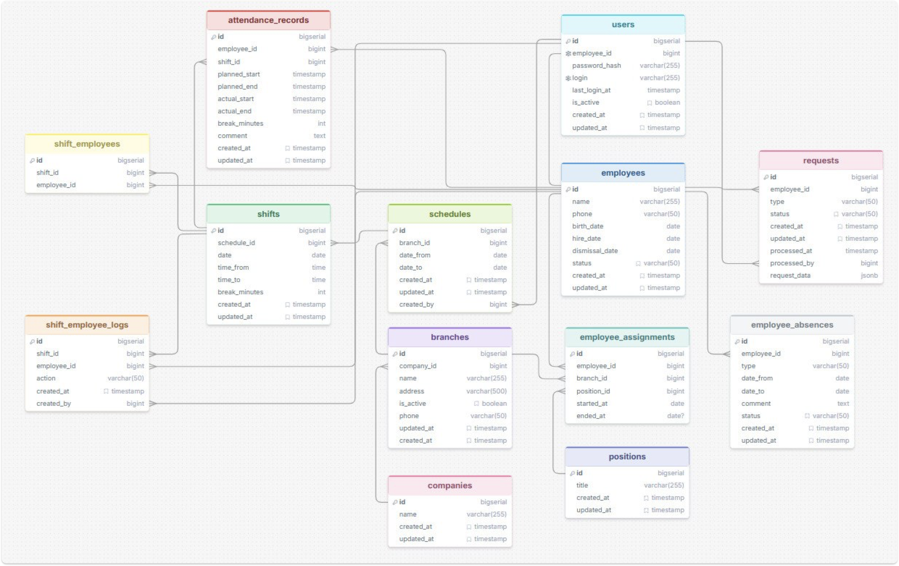

# Высокопроизводительные системы (ИТМО, 4 курс)

Комплексный архитектурный проект корпоративной бэкенд-системы кадрового учета и планирования рабочих смен на стеке **Java 21 LTS / Spring Boot 3 / PostgreSQL / Docker Compose**.

---

## 🏛 Архитектура системы

  

Система реализует строгие бизнес-инварианты для учета сотрудников, структурных подразделений, квалификационных категорий и посменных графиков (сопоставление запланированных смен и фактической отработки):

* **Транзакционная модель:** строгая изоляция ACID, защита от race conditions при параллельном бронировании и редактировании смен, оптимистические блокировки.
* **Аудит-логгинг:** отслеживание изменений состояния сущностей, фиксация авторства и времени мутаций через Spring AOP.
* **Миграции БД:** версионирование схемы через Flyway.
* **Контейнеризация:** оркестрация приложения и PostgreSQL через Docker Compose с healthcheck-пробами.

---

## 🗂 Структура лабораторных модулей

| Модуль | Стек | Описание и архитектурный фокус |
| :--- | :--- | :--- |
| [**Лабораторная №1**](./lab1) | `Spring Boot 3`, `Hibernate/JPA`, `PostgreSQL` | Проектирование реляционной модели данных, RESTful API контроллеры, DTO-трансформации, валидация входных данных (`jakarta.validation`). |
| [**Лабораторная №2**](./lab2) | `Spring Data JPA`, `Transactions`, `PostgreSQL` | Сложные транзакционные сценарии, кастомные JPQL/SQL запросы, пагинация, фильтрация и сортировка. |
| [**Лабораторная №3**](./lab3) | `Spring AOP`, `Audit Logging`, `Security` | Реализация подсистемы сквозного аудирования действий пользователей, перехват изменений сущностей, валидация бизнес-правил планирования смен. |
| [**Лабораторная №4**](./lab4) | `Docker Compose`, `Flyway`, `Production Config` | Docker-контейнеризация, автоматические миграции БД, переменные окружения, профилирование (dev/prod), экспорт OpenAPI / Swagger. |

---

## 🛠 Технический стек

* **Среда выполнения:** Java 21 LTS
* **Фреймворк:** Spring Boot 3.x (Spring Web, Spring Data JPA, Spring AOP)
* **СУБД:** PostgreSQL 16
* **Миграции:** Flyway
* **Контейнеризация:** Docker, Docker Compose
* **Сборка:** Apache Maven
* **Теоретические материалы:** [Архитектурные руководства и конспекты к защите (`theorymd/`)](./theorymd)
